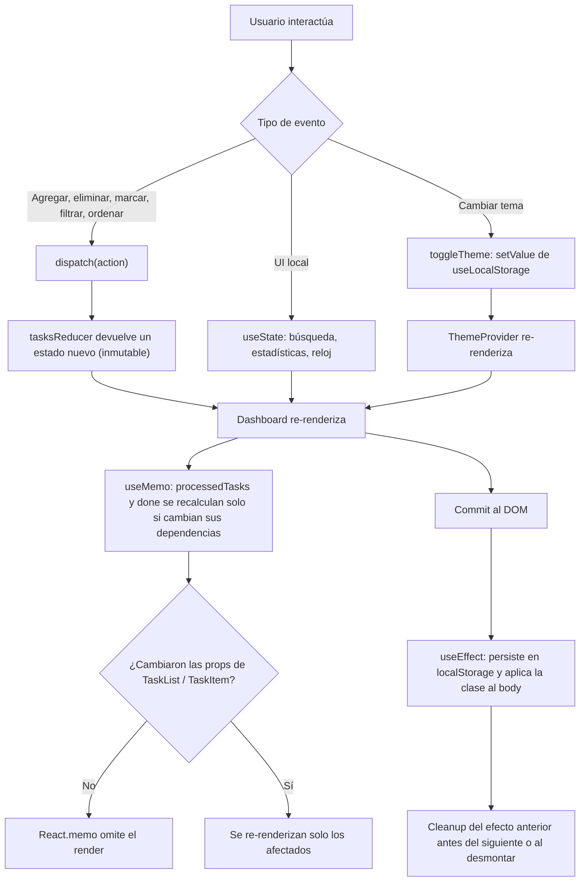
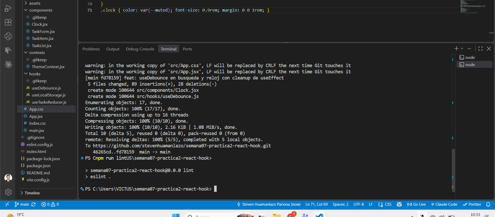
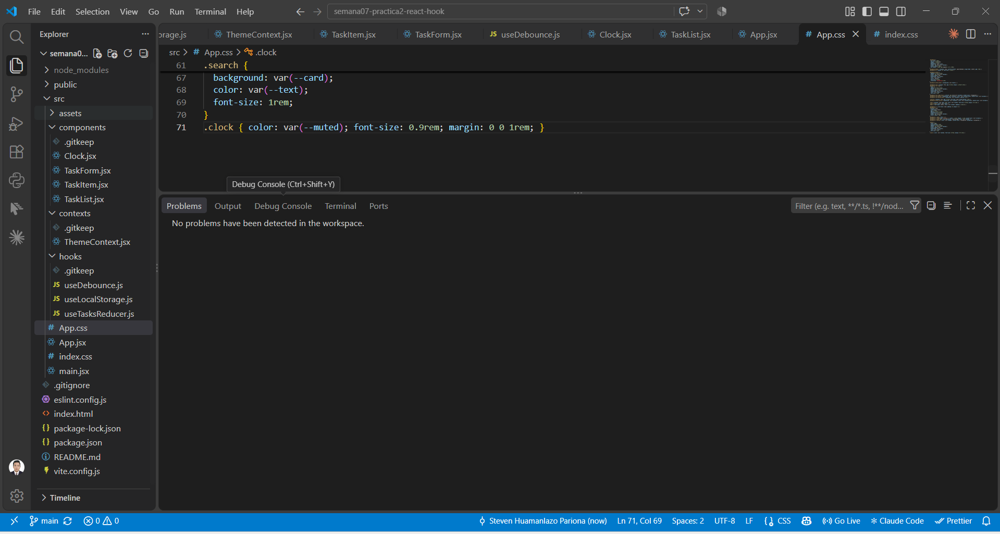
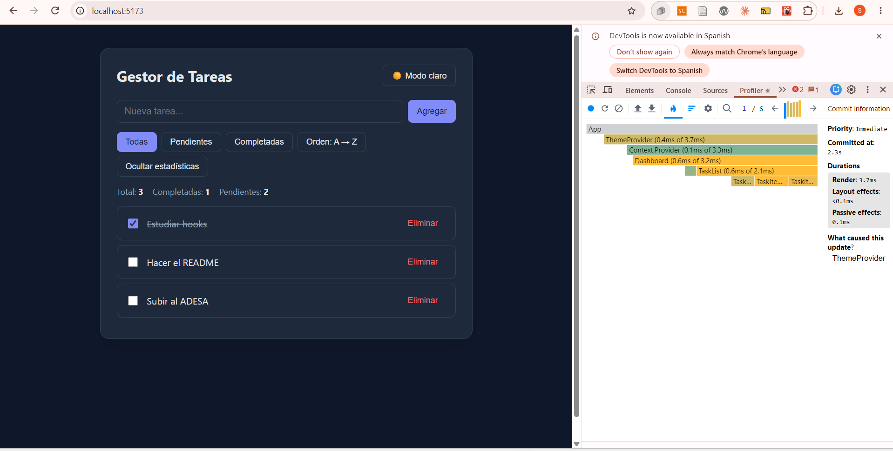
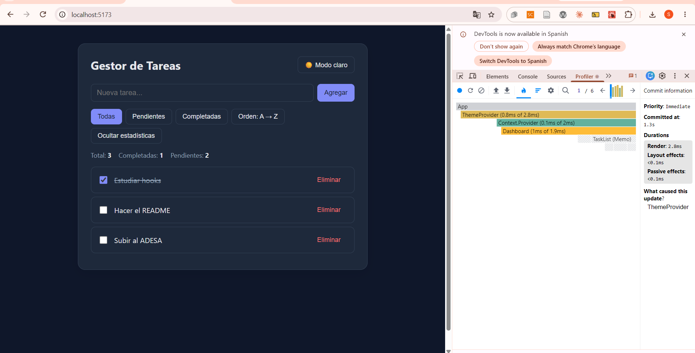
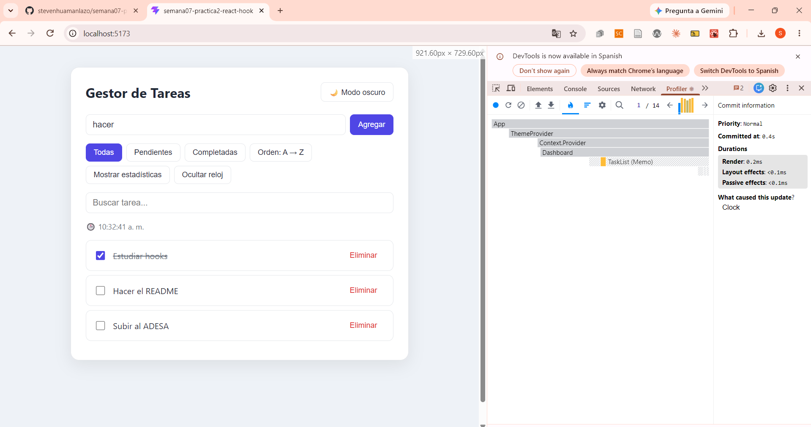
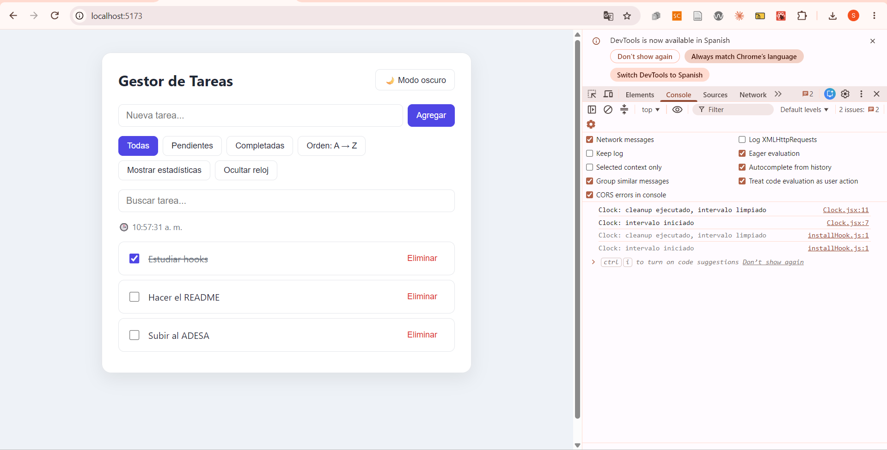
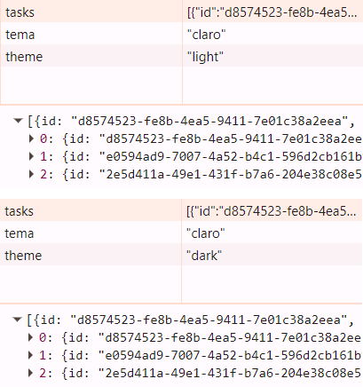
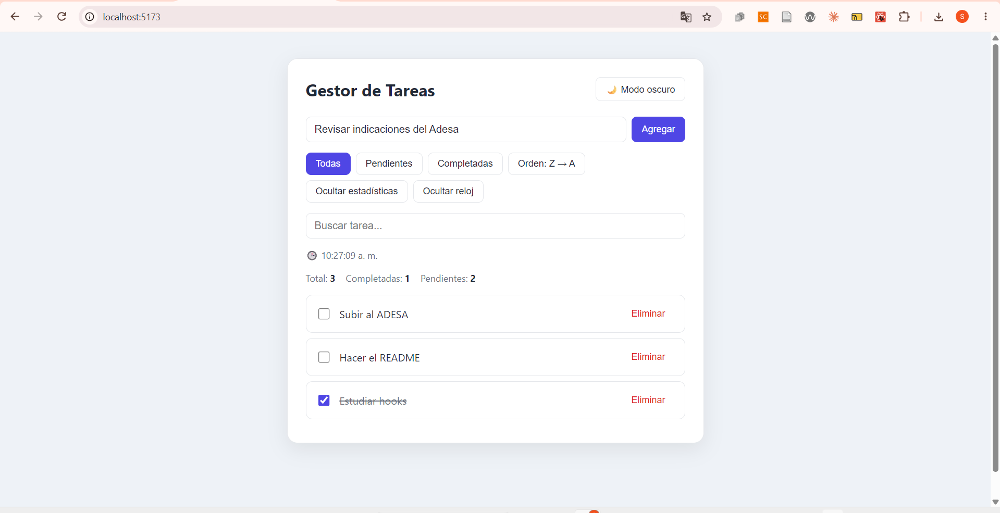
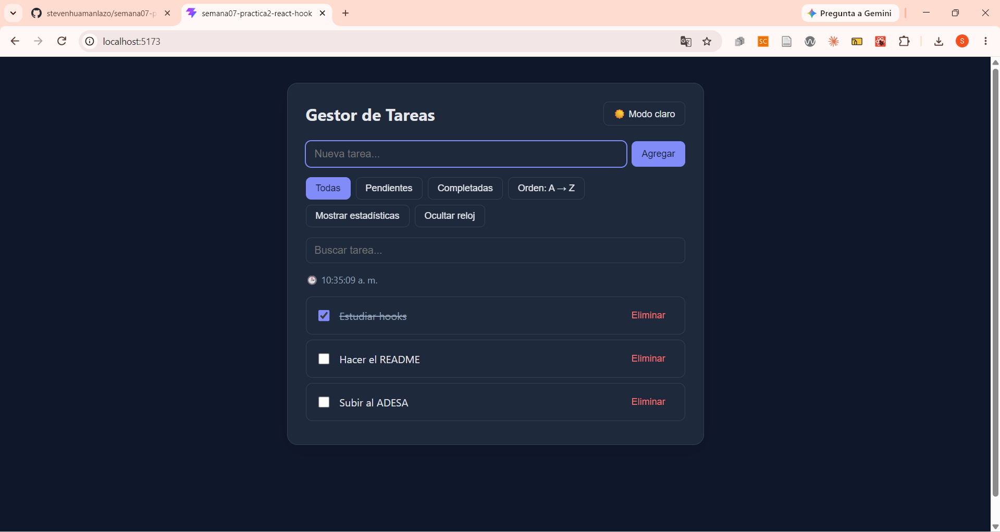

# Dashboard de Gestión con Estado Complejo

## 🌐 Demo en vivo

**https://stevenhuamanlazo.github.io/semana07-practica2-react-hook/**

**Alumno:** Steven Huamanlazo Pariona
**Asignatura:** Desarrollo de Aplicaciones Web (IS093A)
**Unidad I:** Desarrollo Web Frontend
**Práctica:** Semana 07, 2ª parte — React Hooks

Gestor de tareas hecho con React + Vite que integra `useReducer`, `useState`, `useContext`, `useEffect`, `useMemo`, `useCallback`, `useRef` y dos hooks personalizados (`useLocalStorage`, `useDebounce`).

## Ejecutar

```bash
npm install
npm run dev
npm run lint
```

## Estructura

```
src/
├── components/   Clock, TaskForm, TaskItem, TaskList
├── contexts/     ThemeContext.jsx
├── hooks/        useTasksReducer.js, useLocalStorage.js, useDebounce.js
├── App.jsx
└── main.jsx
```

## Diagrama de flujo de estado y ciclo de render



## Justificación técnica de cada hook

| Hook | Dónde se usa | ¿Por qué no `useState` simple? |
|---|---|---|
| `useReducer` | `App.jsx` + `useTasksReducer.js` | El estado tiene varios sub-valores (`items`, `filter`, `sort`) y cada actualización depende del estado anterior. El reducer centraliza la lógica, es una función pura y fácil de probar, y obliga a la inmutabilidad. Con varios `useState` la lógica quedaría dispersa en handlers. |
| `useState` | Búsqueda, mostrar estadísticas, mostrar reloj, texto del formulario | Es estado local de UI, simple y sin relación con la lista. No justifica un reducer. |
| `useContext` | `ThemeContext.jsx` | El tema lo consumen varios componentes. El contexto evita pasar `theme` por props (prop drilling). Se usa para un valor que cambia poco, como recomienda la guía. |
| `useEffect` | Tema en `<body>`, persistencia en `localStorage`, reloj, `useDebounce`, `useLocalStorage` | Sincroniza React con sistemas externos (DOM, storage, timers). Cada efecto con recursos tiene **cleanup**: se quita la clase, se hace `clearInterval`, `clearTimeout` y `removeEventListener`. |
| `useMemo` | Lista filtrada/ordenada en `TaskList`, contador `done`, `value` del contexto | Evita recalcular filtrado y orden en cada render y mantiene estable la referencia del objeto del contexto. |
| `useCallback` | `handleAdd`, `handleRemove`, `handleToggle`, `toggleTheme` | Estabiliza funciones pasadas a hijos envueltos en `React.memo`. Sin esto, cada render crearía una función nueva y anularía la memoización. No se aplicó a los botones nativos del DOM porque no aporta (sin overuse). |
| `useRef` | `TaskForm.jsx` | Da acceso al nodo del input para el auto-focus sin provocar re-render. |
| `useLocalStorage` (custom) | Tema | Reutilizable: encapsula lectura perezosa, persistencia y sincronización entre pestañas. |
| `useDebounce` (custom) | Buscador | Reutilizable: evita filtrar en cada tecla y cancela el timer anterior con cleanup. |

## Validaciones (Entregable 2)

### 1. ESLint: cero warnings de `react-hooks/exhaustive-deps`




**Explicación:** Ejecuté `npm run lint` y terminó sin errores ni advertencias; la pestaña Problems de VS Code tampoco muestra problemas. La regla `react-hooks/exhaustive-deps` revisa que todo lo que se usa dentro de `useEffect`, `useMemo` y `useCallback` esté en su arreglo de dependencias; si falta una, el efecto trabaja con datos viejos.

### 2. React DevTools Profiler: antes y después de la memoización

Antes (`baseline-sin-memo`): en un cambio de tema se re-renderizaron `Dashboard`, `TaskList` y los tres `TaskItem`.



Después (`React.memo`, `useMemo`, `useCallback`): `TaskList (Memo)` y los `TaskItem` no se re-renderizan en el mismo cambio.





**Explicación:** En cada grabación hubo 6 commits; el primero lo provocó el cambio de tema. Antes de memoizar se re-renderizaban `Dashboard`, `TaskList` y los tres `TaskItem`. Después, `TaskList` y los `TaskItem` aparecen rayados porque `React.memo` los salta, y los handlers mantienen su referencia gracias a `useCallback`. El primer commit bajó de 3.7 ms a 2.8 ms. Los commits son los mismos, pero se re-renderizan menos componentes. No usé `useCallback` en botones nativos porque no están memoizados y sería overuse.

### 3. Cleanup de `useEffect`



**Explicación:** Al ocultar el reloj, la consola muestra "Clock: cleanup ejecutado, intervalo limpiado", y al mostrarlo de nuevo "Clock: intervalo iniciado". Sin el `clearInterval` quedaría un intervalo huérfano corriendo (memory leak). Los mensajes se repiten porque en desarrollo React Strict Mode monta, desmonta y vuelve a montar el componente.

### 4. Persistencia en localStorage



**Explicación:** El hook `useLocalStorage` guarda el tema con un `useEffect`, y `App` guarda las tareas con otro efecto. Se ve `tasks` con las 3 tareas y `theme` cambiando de "light" a "dark" (la clave `tema` es de otro proyecto en el mismo puerto). Al recargar, el estado se inicializa leyendo de localStorage, por eso se conservan.

### 5. Interfaz




**Explicación:** El tema claro y el oscuro se aplican con una clase en el `<body>` que `ThemeContext` agrega y quita en un `useEffect` con cleanup, y la preferencia se conserva en localStorage.

## Correcciones al código base de la guía

- `ThemeContext`: `toggleTheme` no estaba definida; se agregó con `useCallback`, se persiste el tema y se aplica la clase al `<body>` con cleanup.
- `useTasksReducer`: se definieron los tipos de acción y casos inmutables. El `id` se genera fuera del reducer para mantenerlo puro. Se agregó `TOGGLE`.
- `TaskList`: el `<input>` estaba dentro del `<ul>` (HTML inválido) y se movió a `TaskForm`. Las dependencias de `useMemo` incluyen `filter`, `sort` y `query`.
- `useLocalStorage`: implementado con inicialización perezosa, `try/catch` y sincronización entre pestañas.